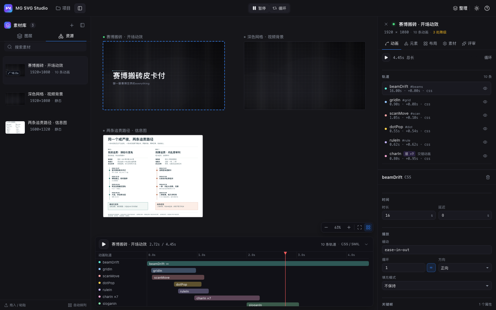
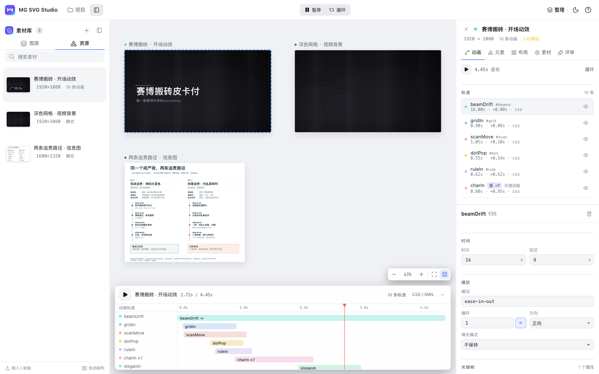
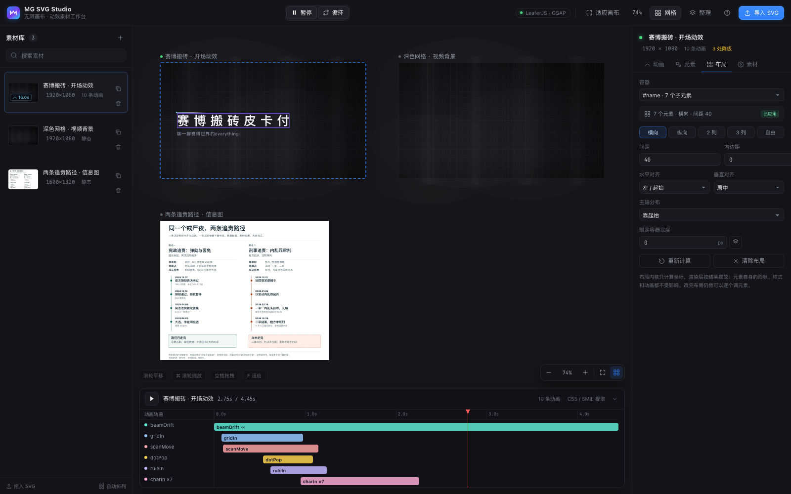
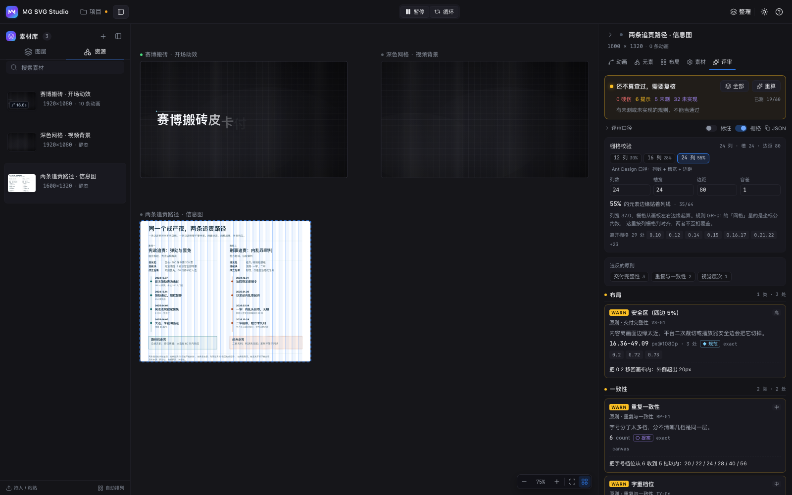
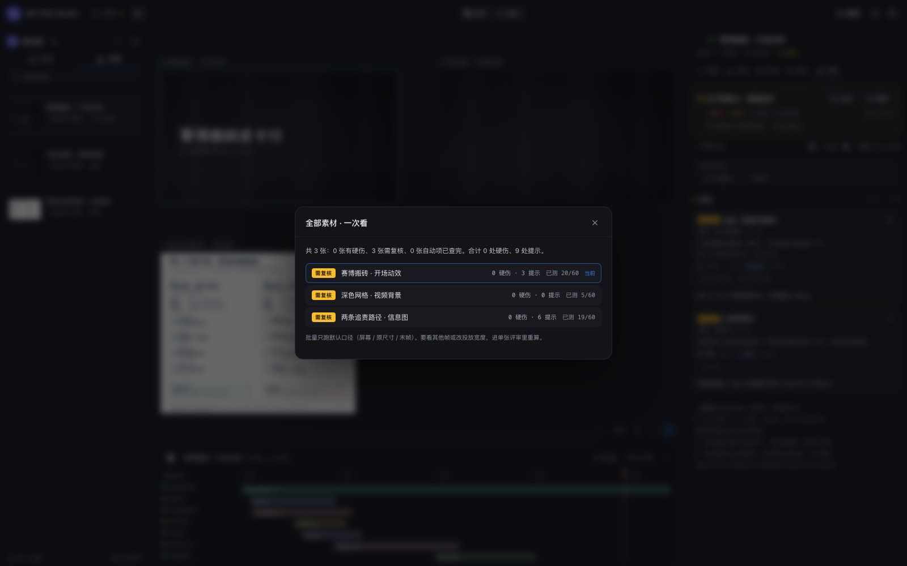

# MG SVG Studio

一个面向 **MG 动画素材**的无限画布工作台：基于 **LeaferJS** 渲染，动画由 **GSAP** 驱动。
目标不是从零做动画，而是把已经在用的 SVG 素材变成「可浏览、可调参、可复用」的资产。



浅色主题（右上角 ☀ / ☾ 切换，选择会记住）：



## 它解决什么

做 MG 动画时，SVG 素材通常散落在工程目录里：动画参数写死在 `<style>` 的 `@keyframes` 里，静态图的配色改一次要开编辑器。这个工具把它们放到一块无限画布上，并且：

1. **展示**：所有素材平铺在无限画布上，自动播放、可缩放平移、按网格排列；缩略图取动画中后段的定格，不会停在黑帧。
2. **把动画抽成参数**：解析 SVG 里的 CSS `@keyframes` 与 SMIL，把每个动画拆成「轨道组 + 属性轨道 + 关键帧」，在右侧侧边栏里改时长、延迟、缓动、循环、方向、每个关键帧的值，画布实时重放。
3. **改静态元素样式**：点画布上的图形（或右侧元素树），改填充、描边、宽度、透明度、圆角、文本、字号、字距、旋转、缩放。
4. **网格**：点阵/线格随缩放自适应切换（Figma 同款行为），并支持按网格自动整理素材。
5. **布局内核**：选中容器 `g`，用声明式 spec（横向/纵向/网格、间距、对齐）重排子元素。
6. **分层动画**：逐字动画自动合并成可整体编辑的层，带交错延迟；也支持多选元素手动成层。
7. **深浅主题**：右上角一键切换画布与界面配色，选择记在 localStorage。
   - 用左上角「素材库」切换左栏。左栏有「素材」和「图层」两个页签，图层可搜索、折叠分组和多选。用右上角「检查器」或点画布元素打开右栏。
   - 组件与图标沿用 `@tita-agent/ui`（shadcn/radix + lucide）：`src/ui/kit/` 与 `src/ui/Icon.tsx`，Tailwind 只取 theme/utilities 层，颜色映射到本项目的 CSS 变量。
   - 缩放 / 适应画布 / 网格只在右下角浮层出现一次；文件操作（打开 / 保存 / 重载）在左上角。
8. **Agent 友好**：项目是本地 JSON 文件，提供 `mgsvg` CLI 与 MCP server，Agent 可直接读写。
9. **文案与语音**：每个素材可以带一段视频文案和录音；卡片上画面和文案条分成两个区，时间轴里多一条带波形的语音轨，播放时和动画同步。

## 快速开始

```bash
cd mg-svg-studio
pnpm install
pnpm dev          # http://localhost:5188
```

生产构建：

```bash
pnpm build
pnpm preview      # http://localhost:4179
```

首次打开会自动载入三份内置示例（来自仓库外的真实 MG 素材）：动效开场、深色网格背景、静态信息图。
也可以直接拖 SVG 文件进画布。

> 素材与修改保存在浏览器 IndexedDB，不上传服务器。换浏览器/清缓存会重置。

## 动画能被“抽出来”的边界

| 来源 | 可编辑性 | 说明 |
| --- | --- | --- |
| CSS `@keyframes` | ✅ 完整 | 解析 `animation` 简写与长写、`animation-delay: calc(var(--d) - var(--t))` 这类时间轴偏移、`transform-box: fill-box` 的变换原点 |
| SMIL `<animate>` / `<animateTransform>` | ✅ 主要字段 | `values` / `from` / `to` / `dur` / `begin` / `repeatCount` / `keyTimes` |
| JS 驱动（GSAP、anime.js、lottie-web） | ⚠️ 只渲染，不抽取 | 动画参数不在 SVG 文件里。工具照常渲染静态画面，并提供「手动添加动画」按元素重建 |

侧边栏支持编辑的属性轨道：`opacity`、`transform`（translate / rotate / scale / skew 组合）、`letter-spacing`、`fill`、`stroke`、`stroke-width`、`font-size`、`width` / `height`、`visibility`、`stroke-dashoffset`。

缓动既支持 CSS 关键字与 `cubic-bezier()`、`steps()`，也支持 GSAP 的 `power2.out` / `back.out(1.7)` / `elastic.out(1, 0.3)` 这类表达式。

## 布局：把「排布」从渲染里拆出来

布局没有塞进渲染层，而是一个独立内核 `src/lib/layout/`，思路和 Boxwood / Yoga / Taffy 一致：
**声明式描述 → 计算绝对坐标 → 渲染层照着画**。内核不依赖 DOM、Leafer 或 SVG，可以单独测试。

```ts
solveLayout(items, {
  mode: 'grid', cols: 3, gap: 20, padding: 24,
  alignX: 'center', alignY: 'center', justify: 'start', width: 800,
})
// → { boxes: [{ id, x, y, width, height }], width, height }
```

同一个内核被两处复用：

- **画布排布**：「整理」按钮用 2 列网格的 spec 计算所有素材画板的坐标（`store.autoLayout`）。
- **元素重排**：选中一个 `<g>`（例如 `#name`），在右侧「元素」页打开「重排子元素」，预览后应用。
  内核按子元素当前尺寸算目标矩形，只把**位移**写回元素，不动几何与样式，也不影响动画轨道。



这也是这套工具的结构原则：**布局算坐标，渲染只负责画**。SVG 本身没有布局能力，能力来自叠加的那一层内核。

## 分层动画

逐字动画是 MG 里最常见的写法，也是最烦的手工活。工具在抽取阶段就会把
**同名、同时长、同缓动、同关键帧、但目标不同**的动画合并成一条「层」：

```
charIn ×7   0.80s · +0.95s · 交错 0.085s
```

- 时间轴只显示一条 bar，画布上仍然是 7 个字依次落下；
- 侧边栏改一次时长 / 缓动 / 关键帧，整层一起变；
- 「交错延迟」单独可调，决定层内每个目标的错开量；
- 手动创建：在元素树里 ⌘/Shift 多选（会按 X 坐标排序），点「合并为一条分层动画」，选属性、起止值、时长与交错即可。

层只是派生视图：运行时仍按每个目标展开成独立的时间区间，所以 seek、循环、方向、填充模式都和单元素动画一致。

数据结构上就是一条 `AnimGroup` 多了两个字段：

```ts
{ name: 'charIn', targetIds: ['…赛', '…博', …], stagger: 0.085, duration: 0.8, delay: 0.95 }
```

## 文案与语音：一张卡片，两段内容

视频文案记在素材上，不另建对象。画布上的卡片因此只有一个选中框，但内部是两个区：

```
┌───────────────────────┐
│        画面（SVG）     │
├───────────────────────┤  ← 1px 分隔线
│ ▎视频文案        31 字 │  ← 左侧色条 + 字数，说明这是文案区
│ 捡垃圾：今晚…          │
└───────────────────────┘
```

- 画面区随素材尺寸变化；文案条紧贴画面下沿、满宽，靠底色 + 分隔线 + 左侧色条和画面上分开，但仍是同一张卡片。
- 文案条固定容纳三行（13px/18px），超出用省略号；完整内容在右侧「视频文案」里改。
- 语音录在当前素材上（`voiceoverAudio`，data URL），不单独占素材位。

有语音时，底部时间轴会多一条**语音轨**，和动画轨道同一条时间尺：

- 波形按真实时长铺开，标签上标时长；语音比动画长时，波形在动画结束处截断并标 `+2.5s`。
- 点时间轴的播放键，语音跟动画一起走；暂停、拖动定位、循环重播都会同步。打开项目时的自动播放保持安静，避免一进页面就出声。
- 语音轨左侧可静音；点击轨道任何位置都能定位。

## 视觉评审：把「看着不对」变成可复核的数字

侧边栏的「评审」页签给当前这一帧做量化体检。它不回答「好不好看」，只回答三件事：
**这一处破坏了哪条原则、测出来的数是多少、证据在哪**。



打开页签就会自动跑一次（约 0.2–0.5 秒），结果是可复现的：同一份输入每次得到同一个 `inputHash`。

### 两路数据，各管一段

| 数据 | 来源 | 能判什么 |
| --- | --- | --- |
| 元素坐标 | 浏览器真实布局（`getBoundingClientRect`） | 溢出、出画、对齐、间距、网格、字号与行高、层级落差 |
| 像素 | 定格帧光栅化后逐点取样 | 对比度（WCAG 公式）、调色板、负空间 |

属性只用来解释「为什么」，不用来当「是多少」：`fill="#888"` 不等于屏幕上的颜色，`font-size="48"` 也不等于渲染尺寸。
所以字号、位置一律在渲染结果上量，颜色一律在像素上取样。

正反例样本集中在 [quant-visual-review-正反例表.csv](output/2026-11-07/quant-visual-review-%E6%AD%A3%E5%8F%8D%E4%BE%8B%E8%A1%A8.csv)：每个案例单独一行，用「案例类型」标记正例或反例。Agent 评审提示词会按规则名称带入对应参考案例；这些参考只用于校准判断，不代表当前素材的结论。

### 定格一帧再量

动画素材要先定格才可测：

1. 把 SVG 挂进 shadow root，素材自带的 `<style>` 不会污染界面，界面样式也进不来；
2. 检查器用 Studio 播放器定格素材的末帧，再把动画与布局写回用于测量的 SVG；
3. 把 computed style 烘回内联样式，序列化成静态 SVG 再光栅化——带 `@keyframes` 的 SVG 直接光栅化只会得到 t=0，量到的就和画面对不上了。

### 把结论叠回画面

评审结果不只是一列数字，它知道自己指的是哪一块画面：

- 打开「画布标注」，当前素材会定格到末帧。色框圈住出问题的元素，角上挂 `规则号` 标签。继续播放或离开末帧时，标注会收起。
- 点面板里的卡片，画布上只留这张卡的标注，其余淡出；点画布上的标注，面板自动聚焦到那张卡片。
- 没开「画布标注」时，选中一张卡也会把它的框画上去——**选中评审，图上就有**。
- 标注画在根空间，不随缩放变大变小；字号小于 45% 时收起点上标签，只留框，避免糊成一片。
- 标签默认贴在框的右上角；贴到画板边缘就依次让到画板外侧、画板上下留白，最后才落回框内——任何情况下都不压住阅读起点。

画面级判定（间距体系、调色板、层级落差这类没有单一元素的规则）标不上去，面板会写明有几条属于这一类。

### 栅格校验：按 Ant Design 的列栅格看对齐

对齐不是「看着挺齐」，是有没有一根共同的列线。打开「栅格」，画板会铺出 **列栅格**——不是坐标纸，是 Ant Design 那套 **列数 + 槽宽 + 边距** 的结构：

```
列宽 = (画布宽 − 边距 × 2 − 槽宽 × (列数 − 1)) ÷ 列数
第 i 列起点 = 边距 + i × (列宽 + 槽宽)
```

- 顶部三档常用列数各带一个百分比（`12 列 78% · 16 列 62% · 24 列 41%`）：**这张图是按几列排的，一眼就能看出来**，点一下切过去。
- 列数、槽宽、边距、容差都能手改，改完立刻重算重画；参数记在 localStorage，换素材不变。
- 「边距」右侧会出现内容的**常见左边缘**（`用 80`）：点一下把容器边距对上它——这一步经常能把对齐率从个位数拉到一半以上（示例图：8% → 55%）。
- **对齐率** = 元素左/右边缘落在任意列线 ± 容差内的占比。它只描述「共享同一套列骨架」的程度，不判好坏——78% 的一版可能比 95% 的更接近作者意图，栅格是给你看，不是给你打分。
- 「离开栅格」列出没贴列线的元素，点一下在画布上定位：先看它们，再决定是改元素还是改栅格。
- 规则 GR-01 的「网格」量的是坐标公约数（元素 x/y 的最大公约数），和这里的列栅格是两件事：**工具看列，规则看公约数**，互不覆盖，卡片里仍然按规则库的口径判。

### 单张还是全部

两个层级，别混：

| | 单张 | 全部 |
| --- | --- | --- |
| 入口 | 选中素材 → 评审页签自动跑 | 评审卡片右上「全部」 |
| 范围 | 末帧，口径可调（媒介 / 投放宽度 / 字号阶梯） | 每张素材各跑默认口径（屏幕 / 原尺寸 / 末帧） |
| 产出 | 完整 findings（正例、反例、未测）+ 覆盖率 + 画布标注 + 栅格 | 一张总表：每张的闸门、硬伤/提示、已测条数，点一行进单张 |
| 用途 | 改之前先确认「这一处到底错在哪」 | 交付前确认「哪几张不能发」 |

批量是串行跑的：每次都要挂一张 1920×1080 的临时画布，并发会顶到内存。



### 重算按钮与 CLI：为什么两套都要

评审必须**在浏览器里跑**——要真实的 `getBoundingClientRect` 和真实像素，Node 侧没有布局引擎，算不出来。所以：

- **人**改完素材，点「重算」，0.2 秒出结果；
- **Agent** 用 CLI，它起一个无头 Chrome 打开正在跑的 Studio，把页面里算好的结果取回来：

```bash
mgsvg review examples/demo.mgsvg                     # 读项目里存的快照，标出过期的
mgsvg review examples/demo.mgsvg --run               # 现算一次（Studio 要开着）
mgsvg review examples/demo.mgsvg --run --write       # 现算并写回项目文件
mgsvg review examples/demo.mgsvg --asset 两条追责路径 --run --json
```

`--run` 走的是同一个 `runReviewAll` / `runReview`，所以 CLI 的结论和面板完全一致。跑完的规则评审快照（PASS 正例、FAIL/WARN 反例、未测项 + 覆盖率 + 闸门）挂在 `assets[].review` 上，随项目保存：

```json
{ "review": { "inputHash": "9f2c7a1b", "gate": "REVIEW_NEEDED",
              "counts": { "FAIL": 0, "WARN": 6 }, "coverage": { "measured": 19, "total": 60 },
              "findings": [{ "ruleId": "VS-01", "level": "PASS", "principle": "交付完整性", "fix": "…" }] } }
```

`inputHash` 是「素材 + 覆盖样式 + 口径」的指纹：改过任何一样，CLI 就会把那张标成**已过期**，Agent 就知道该不该重跑，而不是拿旧结论下判断。语义判断单独放在 `assets[].agentReview`，不混入规则评审闸门；两份结果各自带输入指纹。

### 在 Studio 选中元素后交给 Agent

如果 Agent 客户端能运行本地命令，可以用 CLI。在项目目录启动桥即可；Studio 默认连接本机 `7350` 端口，无需修改页面地址。MCP 客户端可以使用仓库自带的配置启动同一个端口，两种启动方式选一种。

```bash
node bin/mgsvg.mjs bridge --port 7350
node bin/mgsvg.mjs context --json
```

读取上下文后，把 `sessionId`、`asset.id` 和 `element.id` 带回编辑命令。即使选区随后改变，改动仍会应用到原先的元素。重新载入或切换项目会生成新会话，旧命令会被拒绝。

```bash
node bin/mgsvg.mjs live --session "$session_id" --asset "$asset_id" --element "$element_id" --set 'fill=#e11d48'
node bin/mgsvg.mjs live --session "$session_id" --add ./art.svg --name '新素材'
node bin/mgsvg.mjs live --session "$session_id" --save
node bin/mgsvg.mjs live --session "$session_id" --reload
```

MCP 用 `studio_context` 读取同一份上下文，再调用 `studio_apply`。上下文包含元素标签、文字、基础样式和覆盖值，可用于「把这个字号加 4」一类相对改动。

```json
{
  "sessionId": "<studio_context 返回的 sessionId>",
  "asset": "<返回的 asset.id>",
  "element": "<返回的 element.id>",
  "style": { "fill": "#e11d48", "fontSize": 32 }
}
```

Agent 的实时样式改动、`live --add` 导入的素材和手动编辑进入同一份项目状态。`live --add` 使用 Studio 的自动排布，保留界面改动。链接可写的本地 `.mgsvg` 后，修改会自动写回文件；首次写入需在 Studio 中按一次 `⌘S` 并授予浏览器写入权限。未链接文件时，修改会自动保存在本机工作区，可用 `⌘S` 另存为 `.mgsvg`。Agent 也可以显式调用 `studio_save` 或 `live --save`。

保存会检查文件是否在打开后被外部改写。遇到冲突时，可先从「项目」菜单导出当前副本，再重新载入磁盘版本。直接写文件的 `mgsvg style`、`mgsvg apply` 和 `project_apply_ops` 适合项目关闭后的批处理。

桥只监听 `127.0.0.1:7350`。Studio 默认尝试连接本机桥；本机页面可直接接入，托管页面需在启动桥前用 `MGSVG_STUDIO_ORIGIN` 指定其完整来源。

### 按什么分类

结论按**「修的时候一起改的那一批」**分成五类，而不是按原则堆在一起：

| 类别 | 装什么 | 规则 |
| --- | --- | --- |
| 排版 | 字号、行高、字体、层级 | QL-03 QL-04 TY-01 TY-04 TY-05 TY-07 TY-08 CT-01 |
| 布局 | 对齐、栅格、间距、留白、出画 | QL-01 QL-02 VS-01 AL-01 AL-02 GR-01 GR-02 NS-01 |
| 对比 | 文字与底色、配色预算、调色板 | CT-02 TX-01 CL-01 |
| 一致性 | 档位收没收敛、同类是否一样 | RP-01 TY-06 SP-01 GE-02 |
| 交付 | 资源坏了，画了也白画 | QL-07 |

为什么不照搬 impeccable 的 audit 五维（可访问性 / 性能 / 主题 / 响应式 / 实现完整性）：那是**代码审计**，测的是 DOM、包体和断点，和一张静态画面无关。能借用的是它 craft floor 的视觉轴——对比、间距、字体、文案、覆盖率，本项目的五类就是这几条轴加上「交付」的落地版。

分类是展示层的东西，**不写进规则库**：`scripts/sync-review-rules.mjs` 同步不会覆盖它，新规则没登记就按 principle 兜底，兜不住的进「其他」，不会消失。组内仍按 FAIL → WARN → 影响程度排序，组头的圆点表示这一组最差的一条。

### 违反的是哪条原则

规则库里的每条规则都挂在一条原则上（亲密性、对比、对齐、负空间、视觉层次、重复与一致性……），面板会在三处把它说出来：

1. 顶部一行「违反的原则」按条数排，点一下只看这一类；
2. 每张卡片第二行是「原则 · 交付完整性」+ 规则号，悬停看这条原则的释义；
3. 超出展示预算的卡片**折成一行也要露出来**（规则号、原则、处数），点开看细节——WARN 不会因为"低影响"就静默消失；
4. 折叠项仍保留原则字段，`findings[]` 里可回查。

### 判定与闸门

```
有 FAIL                        → BLOCKED（先别发）
无 FAIL，但有 WARN / 未测项    → REVIEW_NEEDED（还不算查过）
全部 PASS 且无未测             → 交付项已查完，SHIP 仍由人签发
```

三个维度互不替代：**影响程度**（高/中/低）只决定先修哪个、显示多少；**闸门权限**由 `rules.json` 的 provenance 决定；**媒介**（屏幕/印刷）决定用哪套阈值。
标 `○ 提案` 的阈值与代理模型永远只能 WARN——脚本会强制降级，不会因为它们阻断交付。

每条卡片都带 provenance 标记，先看标记再信数字：

- `◆ 规范`：有出处（WCAG / 规范条文），可对外引用；
- `◇ 惯例`：行业惯例，可辩护但无强制力；
- `○ 提案`：本项目定的值，只保证内部一致，禁止当标准引用。

### 覆盖率是必带项

规则库有 60 条生效规则，浏览器里能测的先有 20 条。没测的不会消失：
`coverage` 逐条列出 `measured / unmeasured / not_implemented / human / na`，展开「覆盖率」就能看到每条为什么没测。

「已测但没有产出记录」一律记 `unmeasured`，不算 PASS——这是避免「一片静默却全绿」的唯一办法。

### 评审口径

- **投放宽度**：决定字号口径。有效字号 = 声明字号 × 投放宽 ÷ 画布宽。填 1920 就是按 1080p 原尺寸看，填 375 就是按手机看。
- **媒介**：屏幕/视频帧用 UI 阈值，印刷/长图用短边比例。
- **定格帧**：检查器固定评审动画末帧。
- **字号阶梯**：填了才判「阶梯外字号」（TY-04），不填就记未测。

### 已知取舍

- 只评审一帧：时序、音画、抽帧不在范围内（规则库对应条目已标 outOfScope）。
- 透明区域按白底合成后取样；深色素材要留意这一条，报告里会写明。
- SMIL 定格在坐标上生效，光栅化副本按静态属性重绘，像素层可能有偏差。
- 装饰图形出血到画外不算裁切（MG 的常规做法）；整块在画布外才提示。
- 外链位图离线无法校验可达性，只有空引用能确定是坏的。
- 文字的框是浏览器布局框，不是墨迹框：很小的字在 3×3 分区里取样不稳，24px 以下只认整框对比度。

### 规则库

阈值只有一个来源：`src/lib/review/rules.json`（取自 `quant-visual-review` 的规则库）。代码里不写死数字。

```bash
node scripts/sync-review-rules.mjs --from ~/.dsh/skills/quant-visual-review/assets/rules.json
```

规则库升级后跑一次即可；新增规则要在 `src/lib/review/rules.ts` 的 `IMPLEMENTED` 表里登记，否则覆盖率会如实标 `not_implemented`。

```
src/lib/review/
  rules.json   规则库快照（阈值 / 影响分级 / provenance）
  snapshot.ts  隔离挂载、定格动画、烘焙样式、光栅化
  boxes.ts     元素框、字号、行高、层级、容器（id 与画布元素一致）
  layout.ts    元素级规则：溢出 / 出画 / 对齐 / 间距 / 网格 / 层级 / 字体系统
  pixels.ts    像素级规则：对比度取样、调色板、负空间
  findings.ts  判定 → finding（影响程度、闸门权限、改法）
  review.ts    编排、覆盖率、闸门、卡片视图
```

Agent 也能直接读结果：跑过一次后 `window.__review` 就是完整的 `findings.json`（findings + coverage + gate）。

## Agent 集成：CLI 与 MCP（文件即真源）

浏览器里的 IndexedDB 只是缓存；**项目文件才是真源**。一个项目就是一个 JSON 文件（默认 `.mgsvg`），
Agent 可以直接读它、改它，工具侧刷新即可看到结果——和直接改 `.excalidraw` 是同一套思路。

```bash
pnpm build:cli                 # 生成 bin/mgsvg.mjs（已随仓库提供）
node bin/mgsvg.mjs help
```

### 项目文件

```jsonc
{
  "format": "mg-svg-studio/project",
  "version": 1,
  "name": "MG 素材示例库",
  "assets": [{
    "id": "a_xxx", "name": "赛博搬砖 · 开场动效", "x": 0, "y": 0,
    "width": 1920, "height": 1080,
    "svg": "<svg …>",
    "elements": [{ "id": "0.79.82", "tag": "g", "label": "#name", "depth": 2, "kind": "group" }],
    "groups": [{ "name": "charIn", "targetIds": ["0.1","0.2"], "stagger": 0.085, "duration": 0.8, "delay": 0.95,
                 "ease": "cubic-bezier(.4,0,.2,1)", "tracks": [{ "property": "opacity", "keyframes": [...] }] }],
    "overrides": { "0.1.11": { "fill": "#e11d48" } },
    "layouts":   { "0.79.82": { "mode": "row", "gap": 40 } }
  }]
}
```

`elements[].id` 是 SVG 文档顺序生成稳定 id；动画、样式、布局都引用它。
`mgsvg outline <file> --elements` 会把这些 id 连同标签一起列出来，Agent 先用它定位。

### CLI

```bash
mgsvg outline examples/demo.mgsvg --elements          # 概览：素材 / 动画 / 元素 id
mgsvg apply   examples/demo.mgsvg --ops ops.json      # 批量改（先校验，再原子写）
mgsvg apply   examples/demo.mgsvg --ops ops.json --dry-run
mgsvg add     examples/demo.mgsvg --svg art.svg --name "新素材" --dry-run
mgsvg replace examples/demo.mgsvg --asset a_xxx --svg art.svg --dry-run # 替换已有素材的 SVG
mgsvg style   examples/demo.mgsvg --asset a_xxx --element '0.79.82.83' --set fill=#e11d48
mgsvg anim    examples/demo.mgsvg --asset a_xxx --group charIn --set duration=1.2 --set stagger=0.06
mgsvg layer   examples/demo.mgsvg --asset a_xxx --group charIn --targets '0.1,0.2,0.3' --stagger 0.08
mgsvg layout  examples/demo.mgsvg --asset a_xxx --container '#name' --mode grid --cols 4 --gap 24
mgsvg review  examples/demo.mgsvg --run --write      # 现算视觉评审并写回快照
mgsvg review  examples/demo.mgsvg --agent-prompt --asset a_xxx --json # 生成语义评审提示词
mgsvg review  examples/demo.mgsvg --agent-result result.json --asset a_xxx --write # 校验并写回 Agent 结论
mgsvg review  examples/demo.mgsvg --agent-result - --asset a_xxx --dry-run < result.json # 只校验
mgsvg bridge  --port 7350                            # 常驻桥：Agent 看你在选什么
mgsvg context --wait 30                              # 读当前选中项（可等新选择）
mgsvg live    --current --add art.svg --name "新素材"   # 导入当前 Studio 素材库
mgsvg live    --current --set fill=#e11d48           # 改界面里选中的那个元素
mgsvg validate examples/demo.mgsvg
```

`--element` / `--group` / `--container` 既接受 id，也接受唯一匹配的 label（如 `#name`、`“赛”`）。

操作类型（`ops.json` 数组）：

| op | 作用 |
| --- | --- |
| `asset.add` / `asset.remove` / `asset.update` / `board.move` | 素材增删、改名、SVG 替换、画布位置 |
| `anim.set` / `anim.update` / `anim.remove` | 整条动画替换 / 改时长·延迟·缓动·循环 / 删除 |
| `anim.layer` | 把一条动画设为多目标分层（`targets` + `stagger`） |
| `anim.keyframes` | 直接替换某个属性轨道的关键帧 |
| `style.set` / `style.clear` | 元素样式覆盖（fill/stroke/opacity/fontSize/...） |
| `layout.set` / `layout.clear` | 容器布局 spec |

写文件前会跑校验（元素/容器引用是否存在、动画时长等），失败不落盘；写入是 `tmp + rename` 的原子替换。

### MCP

```bash
node bin/mgsvg.mjs mcp --project examples/demo.mgsvg --bridge 7350
```

仓库的 `.mcp.json` 指向 `examples/demo.mgsvg`，并启用 7350 端口的实时桥。Studio 会自动连接并接收实时命令。
Claude Desktop / Code 的 `mcpServers` 配置：

```json
{
  "mcpServers": {
    "mg-svg-studio": {
      "command": "node",
      "args": ["/绝对路径/mg-svg-studio/bin/mgsvg.mjs", "mcp", "--project", "/绝对路径/demo.mgsvg", "--bridge", "7350"]
    }
  }
}
```

暴露的 tools：

| tool | 用途 |
| --- | --- |
| `project_schema` | 返回项目 JSON 结构与字段说明 |
| `project_outline` | 素材 / 动画 / 布局 / 元素 id 概览 |
| `project_read_asset` | 读单个素材完整 JSON（可选不含 SVG） |
| `project_apply_ops` | 批量应用操作并写回，支持 `dryRun` |
| `project_add_asset` | 加一份 SVG（自动解析动画与元素索引） |
| `project_validate` | 校验引用一致性 |
| `review_read` | 分别读规则和 Agent 快照；规则结果含正例/反例/未测，并标出过期状态 |
| `review_run` | 起无头 Chrome 在正在跑的 Studio 里现算一次评审，可选写回 |
| `agent_review_prompt` | 生成指定素材的末帧语义评审提示词，包含 SVG、规则、素材 ID 与输入指纹 |
| `agent_review_submit` | 校验 Agent 返回的完整 JSON 结论；可预览或写入 `assets[].agentReview` |
| `studio_context` | 读 Studio 里人此刻选中的素材/元素（含该元素的评审判定），可等新选择 |
| `studio_apply` | 按会话、素材和元素 ID 实时改样式或清除覆盖 |
| `studio_save` | 保存指定会话已链接的本地项目 |

### 和 Web 端的配合

- 顶栏「项目」菜单：打开（⌘O）/ 保存或另存为（⌘S）/ 从文件重新载入；链接到文件并授权后自动保存。
- 也可以直接开 `http://localhost:5188/?project=/examples/demo.mgsvg`，刷新即读取最新文件。
- 项目打开时用实时桥编辑和保存。离线批处理完成后，可用「从文件重新载入」查看磁盘版本。

## 技术实现

```
src/
  lib/
    css.ts        自研轻量 CSS 引擎：选择器匹配、层叠、@keyframes、var()/calc() 时间求值、颜色解析
    matrix.ts     2D 矩阵、SVG transform、CSS transform
    svg-doc.ts    SVG → 文档模型（元素树、渐变、滤镜、动画轨道提取 + 分层合并）
    convert.ts    SVG 模型 → Leafer 图形树（含渐变、虚线、圆角、模糊、混合模式、文本基线）
    runtime.ts    GSAP 动画运行时：spec → 逐帧求值 → 写回 Leafer 节点
    studio.ts     画布：相机、网格、画板、命中测试、选择框、拖拽、布局应用
    layout/       布局内核（纯函数引擎 + Leafer 适配层）
    review/       视觉评审：定格快照、元素与像素测量、分类、覆盖率与闸门
  ui/             顶栏 / 素材库 / 检查器（动画·元素·素材·评审）/ 时间轴 / 画布 HUD
  store.ts        状态 + IndexedDB 持久化
```

几个关键设计：

**渲染层（LeaferJS）**
画布是 `Leafer` 实例，内容挂在一个 `camera: Group` 下，缩放/平移只改相机组的矩阵；网格画在 Leafer 下方的一张 overlay canvas 上，用同一套 `x/y/scale` 计算，所以永远不会和内容错位。选中的画板/元素用屏幕空间的虚线框叠加，缩放时线宽不变。

**SVG → 图形树**
每个可绘制元素（含 `<g>`）都会被包一层 `Group` 作为「动画变换容器」，这样 CSS 动画的 `transform` 只需要写 wrapper 的矩阵，不会破坏元素自身的几何与布局。`transform-origin: fill-box` 会被换算成 wrapper 局部坐标里的枢轴点，先 `T(p) · M · T(-p)` 再与元素自身的 `transform` 属性相乘。

**动画运行时（GSAP）**
`gsap.ticker` 作为全局时钟，统一推进所有画板的播放器；每帧推进后主动同步渲染一帧
（Leafer 自带的 rAF 调度会把相邻两帧合并，实测只有 ~30fps；改为 `forceRender(undefined, true)` 后稳定 60fps）。
值写入带缓存，同一元素/属性没有变化就跳过，避免每帧把整棵树标脏。`gsap.parseEase` 负责 GSAP 缓动表达式，CSS 的 `cubic-bezier()` / `steps()` 由内置求值器处理（不引入额外插件）。每帧按 CSS 的时间语义求值：`delay`、`iteration-count`、`direction`、`fill-mode`，再逐属性插值写回 Leafer 节点。这样拖动时间轴时可以精确 seek 到任意时刻，且多条动画作用在同一元素上时不会互相覆盖。

**持久化**
素材原文、动画轨道、元素覆盖样式都存在 IndexedDB；画板位置也随之保存。

## 部署

纯静态站点（相对 base），可以放站点根或子目录。作为 best_s 的子页面发布到 uniCloud：

```bash
pnpm deploy:unicloud   # 构建 + 同步 + 上传（需 HBuilderX 已打开并登录）
```

线上地址：<https://static-mp-4a67fc4a-c0a2-42b8-bc57-dc718029e4d0.next.bspapp.com/mg-svg/>

也可以拆成两步手动做：`pnpm build:bestory`（同步到 `best_s/public/mg-svg`）→ 在 HBuilderX 里上传。

细节与「替换站点根」的做法见 [docs/deploy-unicloud.md](docs/deploy-unicloud.md)。

## 画布历史与素材版本

- 在「项目 → 画布历史」中查看记录、撤销和重做。快捷键为 `⌘/Ctrl+Z` 和 `⌘/Ctrl+Shift+Z`，也可以用 `Ctrl+Y` 重做。
- 右侧检查器的「素材」页提供素材版本，「元素」页显示所选元素的样式、布局和动画改动。素材可恢复完整版本，元素可单独恢复样式和布局。恢复会新增一条可撤销的画布操作。
- 每个项目最近 100 条操作保存在当前浏览器，打开历史可查看时间、受影响的素材和已撤销的操作。新编辑后，原有的重做分支仍可在历史中查看。导出的 `.mgsvg` 保存当前项目状态。

## 已知限制

- `<pattern>` 填充、`feTurbulence` 这类噪点/纹理滤镜、复杂 `<mask>` 会被忽略，并在「素材」面板里列成降级项。
- `<use>` 引用不会展开；`<foreignObject>` 不支持。
- 渐变的 `gradientTransform` 暂未完全还原（线性/径向的基本方向与 stop 正确）。
- 文本按基线换算，多行只在 `<tspan>` 用绝对 `y` 时近似。素材里的 `@font-face` 会注册进页面：`local()` 引的系统字体和 `data:` 内嵌字体可用，相对路径或网络 URL 不加载，回退到系统字体；字体没装上时控制台会报一条 `[mgsvg]` 提示。
- 布局按元素静态尺寸计算。横排可以换行，文本内部排版沿用素材设置。
- 布局重排的是容器直接子元素；深层嵌套需要逐层应用。
- 视觉评审只测单帧，且规则库 60 条生效规则里浏览器能测 20 条，其余在面板里逐条标未实现。

## 后续可以加

- 导出：把修改后的动画 spec 反向生成 SVG（CSS keyframes）或 GSAP 代码。
- 多选与成组、画板内拖拽元素。
- 素材版本与团队共享（当前是纯本地）。
- 用 OffscreenCanvas / 视口剔除支撑上千个动画素材。
