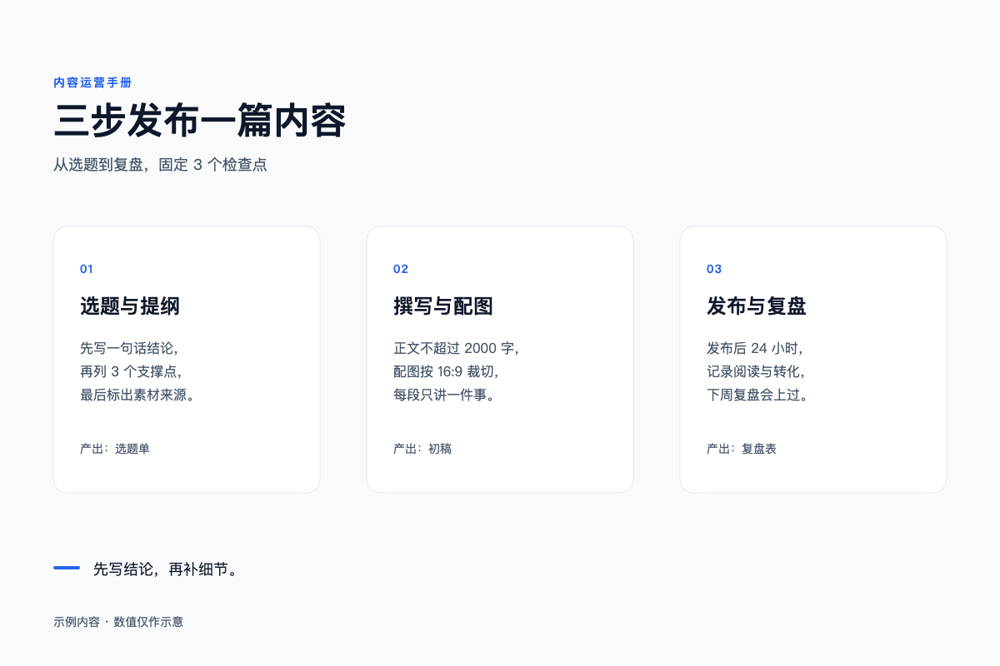

# SVG 生成提示词库

从 `quant-visual-review-正反例表-融合版.csv` 的 23 条规则提取。做法是：把每条规则的判定条件、阈值和反例，翻成一句生成时必须满足的话，再拼成可以直接粘贴的提示词。

表里的数值可信度不一样：WCAG 是标准，8dp 是行业惯例，2px / 0.8 / 3% 只是提案。下面每句都标了强度，别把提案当规范用。

## 怎么用

1. 贴「通用系统提示词」（第一节），把画布尺寸换成你要的。
2. 加一个「场景包」（第三节），只要一段。
3. 写内容：主题、3–5 个要点、要出现的文字。
4. 出图后跑「自检清单」（第六节）。
5. 有问题按「改图模板」（第七节）回一轮，只改被点名的元素。

---

## 一、通用系统提示词

```
你是一名信息设计师，把内容做成一张能直接渲染的 SVG。

【输出】
只输出一个 <svg>，viewBox="0 0 1200 800"，不要解释文字。
不引用外部图片、字体、CSS、脚本；样式写在元素属性或 <style> 里。
中文字体用 font-family="'PingFang SC', 'Hiragino Sans GB', 'Microsoft YaHei', 'Noto Sans SC', sans-serif"。

【布局】
- 8px 网格：元素边界、卡片坐标都落在 8 的倍数上。页面边距 64px。
- 间距只用 8/16/24/32/48。同一组内统一一档；组与组的距离至少是组内的 2 倍。
- 同列的左边界 x 相同，同行的基线 y 相同，偏差不超过 2px。
- 同一角色的元素（卡片、图标、标签）尺寸、圆角、线宽一致。

【文字】
- 字号最多 5 档，常用 4 档更好；字重最多 2 种（400 / 600）。
- 正文不小于 14px，辅助说明不小于 12px。
- 中文行高 1.6–1.75 倍，标题 1.1–1.25 倍。
- 中文每行不超过 40 字，英文不超过 80 字符。
- SVG 不会自动换行：长句拆成多个 <tspan>，每行手动断好。
- 文字框按内容留 20% 余量，宁可留宽也不要顶满。
- 不用纯抽象图标表达动作或状态；图标旁边必须有文字。

【颜色】
- 单屏最多 4 个颜色：背景、正文、主色、一个语义色。需要状态色时可到 6 个，但每个颜色只对应一个角色。
- 正文对比度不低于 4.5:1；大字（24px 以上或 18px 粗体）和承载信息的图形不低于 3:1。
- 信息不能只靠颜色区分：状态同时用图标、文字或线型。

【层级】
- 全图只有一个视觉焦点：面积最大或对比最强的元素，必须就是主信息。
- 其余元素按 3 级递减：标题 / 小标题 / 正文。
- 一屏 3–5 个信息块，标题层级不超过 3 级。
- 装饰（底纹、装饰线、铺底图标）面积低于 30%。不做大面积渐变、水印、发光。
- 等面积的区块内容量相当，留白均匀，不要一块挤三块空。

【交付】
- 文字不溢出容器、不被画板裁切、不被其他元素遮挡。
- 重要内容距画布边缘不小于 24px。
- 不写占位符、TODO、lorem ipsum。
```

## 二、精简版

上下文紧张或模型较弱时用这段，压到 200 字以内，覆盖最常翻车的几项。

```
做一张 1200×800 的 SVG 信息图，只输出代码。
8px 网格，边距 64，间距只用 8/16/24/32/48，同组统一。
字号 5 档以内，字重 2 种，正文 ≥14px，行高 1.6。
中文每行 ≤40 字，手动换行，文字框留 20% 余量。
最多 4 个颜色，正文对比度 ≥4.5:1，大字和图形 ≥3:1。
只留一个视觉焦点，装饰面积 <30%，一屏 3–5 块。
文字不许溢出、被裁、被挡。
```

---

## 三、场景补充包

在系统提示词后面追加一段，不要全加。

| 场景 | 追加提示词 |
|---|---|
| 信息图 | 3–5 个等宽信息块，每块：一个 24px 以上的结论短语、一行说明、一个数字。块用浅色填充，块间距 48px 左右，取 8 的倍数。 |
| 流程 / 架构 | 横向 3–5 步等宽排列，箭头统一 2px、同一朝向；分支用正交折线不用斜线；连线不穿过文字。 |
| 对比 | 左右两栏等宽，中缝 48px。两侧用不同线型或图标区分，不只换颜色。两栏标题同字号同字重。 |
| 数据图 | 系列不超过 4 个，每个系列有图例和不同线型或标记。坐标轴标签 14px，网格线 1px 浅色。数值直接标在点上，柱宽和间距取 8 的倍数。 |
| 封面 / 标题卡 | 标题不超过 2 行，副标题不超过 1 行。留白不低于 40%。装饰只用一个几何色块或一条线，不铺满。 |

---

## 四、逐条约束句

这张表是「一条规则一句话」。写提示词时按需挑，不必全抄。

| 规则（原则） | 生成时写这句 | 强度 |
|---|---|---|
| 语义分组（亲密） | 同一字段的标签紧贴它的内容；组间距离至少是组内的 2 倍。 | 惯例 |
| 共同区域（格式塔） | 同组内容放进同一个可见容器；一个容器只装一组。 | 提案 |
| 分块与层级（信息组织） | 一屏 3–5 块，标题不超过 3 级。 | 提案 |
| 前景对比度（对比） | 正文对比度 ≥4.5:1，大字和图形 ≥3:1。 | 标准 |
| 颜色非唯一线索（对比） | 状态同时用图标、文字或线型区分，不只靠颜色。 | 标准 |
| 组件一致性（重复） | 同类元素同尺寸、同圆角、同线宽、同色值。 | 惯例 |
| 间距节奏（重复） | 间距只用 8 的倍数：组内 8/16，组间 24/32/48，同组统一一档。 | 惯例 |
| 排版档位（重复） | 字号不超过 5 档，字重不超过 3 种。 | 规范 |
| 色彩预算（重复） | 单屏不超过 4 个色相；每个颜色对应一个角色。 | 惯例 |
| 对齐（对齐） | 同列左边界对齐，同排基线对齐，偏差不超过 2px。 | 提案 |
| 网格（网格） | 所有元素坐标落在 8px 网格上。 | 提案 |
| 主次焦点（视觉层次） | 全图只有一个最显眼的元素，就是主信息；其他元素不许抢。 | 惯例 |
| 信息噪音比（视觉层次） | 装饰面积低于 30%，不做渐变铺底、水印、满版图标。 | 提案 |
| 视觉重量与留白（平衡） | 等面积区块内容量相当，留白均匀。 | 惯例 |
| 字号下限（可读性） | 正文 ≥14px，辅助文字 ≥12px。 | 惯例 |
| 行长（可读性） | 中文每行 ≤40 字，英文 ≤80 字符。 | 规范 |
| 正文排版（可读性） | 中文行高 1.6–1.75 倍，标题 1.1–1.25 倍。 | 惯例 |
| 图形和标签（可读性） | 每个图标配文字标签，不用纯抽象符号表达动作。 | 惯例 |
| 图像比例（可读性） | 位图按原比例缩放，不拉伸；要裁切就明确写 cover。 | 惯例 |
| 资源失效（交付） | 不引用外部资源，所有图片内联。 | 规范 |
| 文本溢出（交付） | 文字留 20% 余量，手动断行，不顶到容器边。 | 惯例 |
| 必要内容裁切（交付） | 重要内容距画板边缘 ≥24px。 | 惯例 |
| 必要内容遮挡（交付） | 角标、弹窗、装饰不压文字。 | 提案 |

---

## 五、负向提示词

从「反例」那列直接抄出来的失败样子。放在最后一段，或者当检查项用。

```
不要出现这些：
- 标签离别人的输入框比自己更近；两组之间没有留白或分隔。
- 同类卡片的尺寸、圆角、色值不一致。
- 间距 16/24/32 混着用。
- 7 个字号档、4 种字重。
- 单屏 7 种颜色，促销色和图标色无法对应角色。
- 元素偏 1px 出网格。
- 装饰横幅比正文更显眼；渐变、水印、图标铺满背景。
- 三块等面积区域内容量 34%、36%、68%。
- 正文 11px；中文一行 52 字。
- 必填项只用红色区分；错误态只把边框变红。
- 只有一个抽象符号，没有文字说明。
- 图片被拉伸变形。
- 文字溢出按钮、被画板裁掉、被关闭图标压住。
```

---

## 六、出图自检

渲染成 PNG 后量，别凭眼睛。前 3 条是硬伤，后 5 条是质量线。

| # | 检查 | 判据 |
|---|---|---|
| 1 | 文字是否超出容器 | 溢出 >0.5px 即不合格 |
| 2 | 必要内容是否被画板裁掉 | 裁切深度 >0.5px 即不合格 |
| 3 | 前景是否压住文字 | 被遮面积 >3% 记问题 |
| 4 | 对齐与网格 | 同列偏差 ≤2px；落网率 ≥80% |
| 5 | 对比度 | 正文 ≥4.5:1，大字/图形 ≥3:1 |
| 6 | 档位预算 | 字号 ≤5 档、字重 ≤3、颜色 ≤4 个色相 |
| 7 | 间距节奏 | 组内同一档；组间 > 组内；只用 8 的倍数 |
| 8 | 主焦点 | 最显眼的元素就是主信息，只有一个 |

量对比度可以直接算：取 sRGB 相对亮度，`(亮 + 0.05) / (暗 + 0.05)`。别用吸管目测。

---

## 七、改图模板

拿到评审结论后，一次只改一处，别重画。

```
第 3 条（间距节奏）：三张卡片之间是 32，卡片内部也是 32，分不开。
只改卡片间距：32 → 56，卡片位置依次右移，尺寸和内容不动。
其余元素、文字、结构保持原样。
```

模板固定三句：问题在哪、改成什么、哪些不许动。模型最容易在「顺手优化」上翻车。

---

## 八、数值从哪来

同一张表里混了四档可信度，抄进提示词前先看清楚。

| 数值 | 强度 | 出处 |
|---|---|---|
| 4.5:1 / 3:1 | 标准 | WCAG 2.2 AA 1.4.3、1.4.11 |
| 颜色不作唯一线索 | 标准 | WCAG 2.2 SC 1.4.1 |
| 行长 80 / 40 字 | 规范 | WCAG 2.2 AAA 1.4.8 |
| 8px 网格 | 惯例 | Material Design 8dp |
| 字号 3–5 档 | 规范 | Ant Design 字体规范（单系统建议） |
| 单屏 4 色 | 惯例 | Shneiderman《Designing the User Interface》 |
| 正文 12 / 14px | 惯例 | Carbon 最小 12px，Ant 正文 14px |
| 行高 1.5–1.8 / 1.25–1.5 | 惯例 | Ant 中文建议、Carbon body 实测 |
| 对齐 2px | 提案 | 无公开规范，工程预设 |
| 落网率 0.8 | 提案 | 无公开规范，工程预设 |
| 遮挡 3% | 提案 | 无公开规范，待项目确认 |
| 装饰 30% | 提案 | 代码库参考值，无公开规范 |
| 溢出 / 裁切 0.5px | 惯例 | 抗锯齿容差 |

提案那几行可以按项目改。改了就写进提示词，别让模型自己猜。

---

## 九、一个填好的例子

```
你是一名信息设计师，把内容做成一张能直接渲染的 SVG。……（贴第一节全文）

【场景】信息图
3 个等宽信息块，每块：一个 24px 以上的结论短语、一行说明、一个数字。块用浅色填充，块间距 48px 左右。

【内容】
主题：三步发布一篇内容
眉标：内容运营手册
标题：三步发布一篇内容
副标题：从选题到复盘，固定 3 个检查点
01 选题与提纲 / 先写一句话结论，再列 3 个支撑点 / 产出：选题单
02 撰写与配图 / 正文不超过 2000 字，配图按 16:9 裁切 / 产出：初稿
03 发布与复盘 / 发布后 24 小时记录阅读与转化 / 产出：复盘表
页脚：示例内容，数值仅作示意
```

对应产出：[SVG生成示例-三步流程.svg](SVG生成示例-三步流程.svg)。可以拿它对照第六节逐条量。



这张图量过的结果：文字全部在卡片内、距边 ≥24px；对比度 17.85 / 7.58 / 4.94；卡片坐标与间距都是 8 的倍数；字号 5 档、字重 2 种、色相 3 个。
